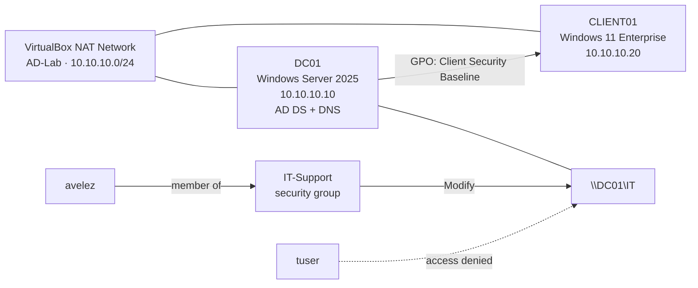
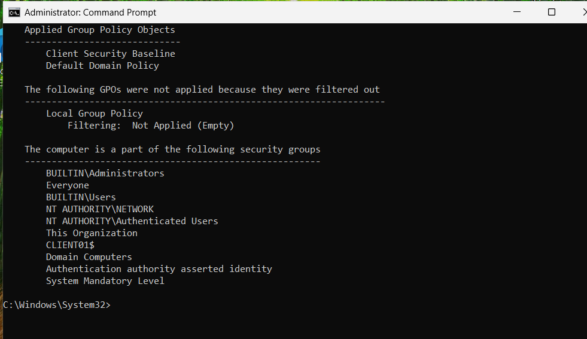
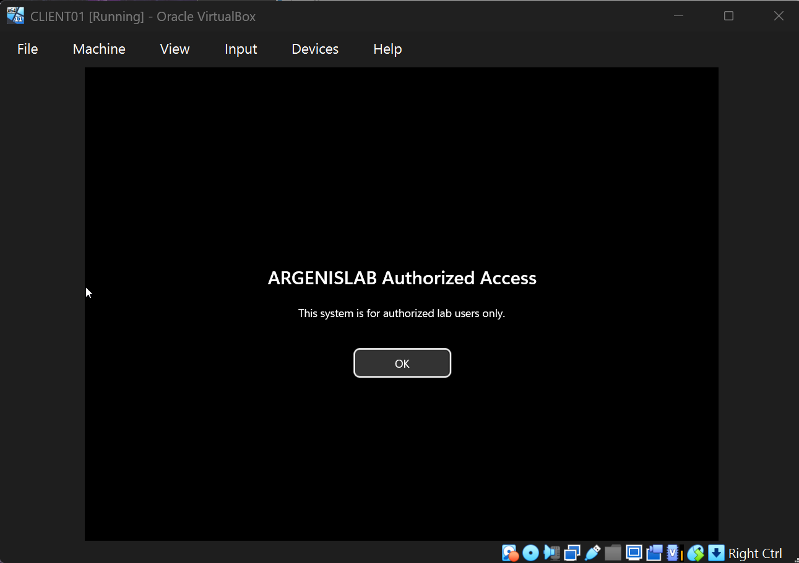
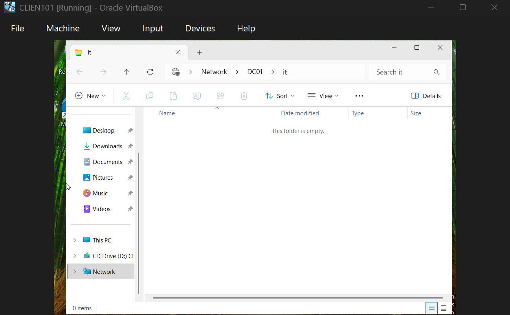
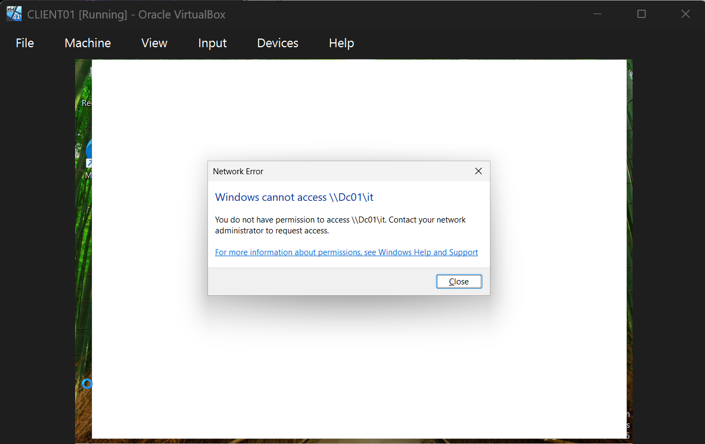

# Windows Active Directory Home Lab

A small Windows domain I built in VirtualBox: a Windows Server 2025 domain controller and a Windows 11 client on an isolated network. I set up AD, DNS, and Group Policy on it, plus a file share that one group can reach and everyone else can't. Then I tested each piece from the client and fixed what broke along the way.



## Setup

| | |
| --- | --- |
| Domain | `argenislab.test` (NetBIOS `ARGENISLAB`) |
| DC01 | Windows Server 2025 Eval · `10.10.10.10` · AD DS, DNS, file server |
| CLIENT01 | Windows 11 Enterprise Eval · `10.10.10.20` · domain-joined |
| Network | VirtualBox NAT Network `AD-Lab`, `10.10.10.0/24`, gateway `.1`, no DHCP |

Both machines use static IPs and point DNS at DC01.

```text
argenislab.test
├── Lab-Users       avelez, tuser
├── Lab-Computers   CLIENT01
└── Lab-Groups      IT-Support (global security group; avelez is a member)
```

## What I configured

**Domain controller.** Gave DC01 a static IP, installed AD DS and DNS, and promoted it as the first DC in a new forest.

**Client.** Set CLIENT01's IP and DNS, confirmed it could resolve the domain's SRV records, joined it to the domain, and signed in as `ARGENISLAB\avelez`.

**Group Policy.** Created a `Client Security Baseline` GPO linked to `Lab-Computers`. It sets a logon banner ("This system is for authorized lab users only."), which makes it easy to see whether the policy actually reached the client. Checked with `gpresult /scope computer /r`.

**File share.** Shared `C:\Shares\IT` as `\\DC01\IT`. With share and NTFS permissions, I gave `IT-Support` Modify and `Administrators` Full Control, and granted nobody else access. `avelez` could open and edit files there; `tuser`, who isn't in the group, got access denied.

| GPO applied | Logon banner | Authorized | Denied |
| --- | --- | --- | --- |
|  |  |  |  |

All eight screenshots, with what each one shows, are listed in [docs/SCREENSHOTS.md](docs/SCREENSHOTS.md).

## Things that went wrong

Some of the most useful parts of the lab came from fixing things. Full notes, with commands and output, are in [docs/TROUBLESHOOTING.md](docs/TROUBLESHOOTING.md).

- **The GPO didn't apply.** `gpresult` only listed the Default Domain Policy. When a computer joins the domain it goes into the default `Computers` container, not my `Lab-Computers` OU, so the GPO linked there never reached it. Moving CLIENT01 into the OU fixed it.
- **The client got a `169.254.x.x` address.** There's no DHCP on this network, and the static config hadn't stuck, so Windows fell back to APIPA. I set the IP and DNS again with `netsh`.
- **DC01 had a `/8` subnet mask** instead of `/24`. It was a typo during setup, and I caught it in `ipconfig`.
- **`dcdiag` reported failures** in the DFSR and System Log tests. I checked DNS on its own (`dcdiag /test:dns` and an `nslookup` of the `_ldap._tcp.dc._msdcs` SRV record), and both passed. The failures were old events logged while the server was being promoted, not a current problem.
- **Setup kept offering to upgrade after the first reboot** because the VM was booting from the ISO again. I ejected it.

The commands I used are collected in [docs/COMMANDS.md](docs/COMMANDS.md), and the design is written up in [docs/ARCHITECTURE.md](docs/ARCHITECTURE.md).

## Next

- DHCP on DC01 instead of static addresses
- Password and lockout policies, firewall GPOs
- A PowerShell script to provision users in bulk
- More shares using AGDLP (domain local groups for permissions, global groups for people)
- Backup and restore of the DC
